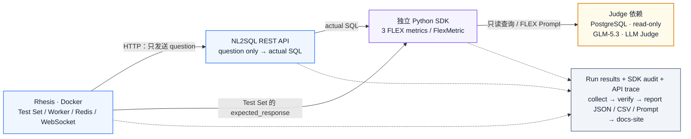
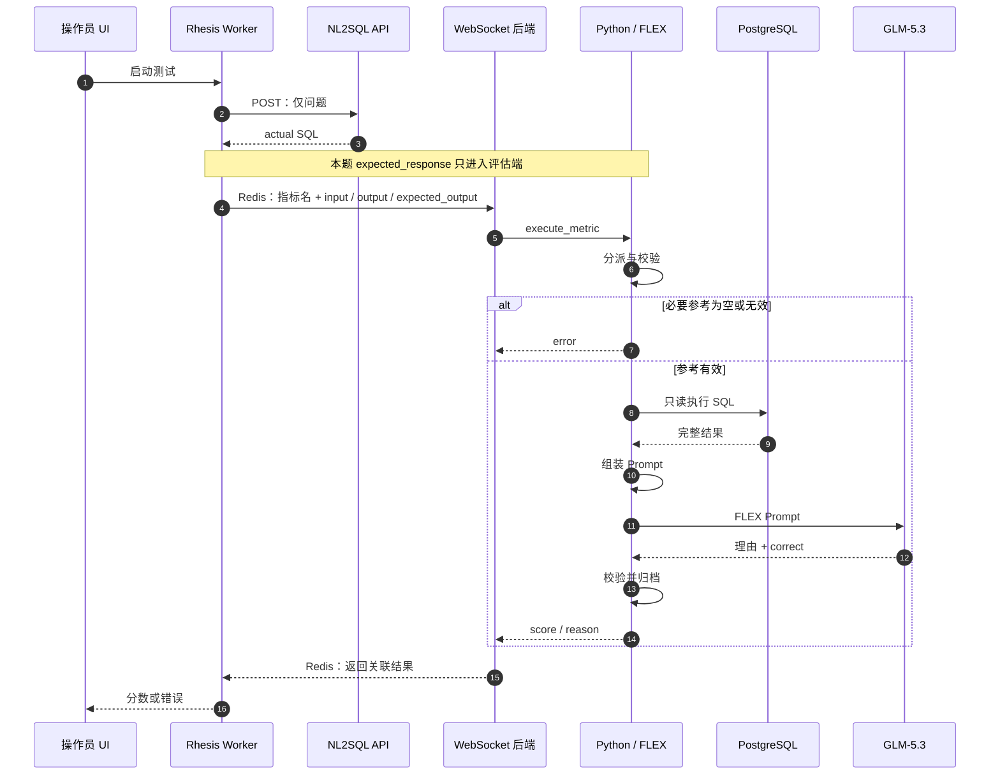

import useBaseUrl from '@docusaurus/useBaseUrl';
import styles from '@site/src/css/rhesis-flex-sdk-guide.module.css';

# Rhesis FLEX SDK Guide

**你写并运行 Python 评分函数，Rhesis 负责把 testcase 和实际 SQL 发给它，再收回分数。** 这个 Python 进程会调用 GLM，所以它仍然是 **LLM as Judge**。

本指南解释已经运行的三套 SDK 指标。跟着第 4 节可以手写自己的入口文件，复用现有 FLEX 评估代码；不需要修改 NL2SQL 或 Rhesis 源码。[现有 90 条结果](./bird-baseline-rhesis-flex-review.md) · [实际执行的完整评分源码](./bird-baseline-rhesis-flex-review.md#sdk-evaluation-code)。

## 1. 代码部署在哪里

**评分代码运行在独立 Python 进程中。** 本次在 Mac 上运行，Rhesis 的前端、后端和任务 Worker 在 Docker 中运行。公司环境可以把评分进程放在服务器或独立容器里；需要保持它运行，并能访问 Rhesis、评分数据库和 GLM。

实线表示运行时请求，虚线表示 Run 结束后的归档来源；Python SDK 主动建立 WebSocket 长连接。窄屏可在图内横向滚动。

不需要把评分 Python 文件上传到 Rhesis 容器。Rhesis 保存指标名称、参数及调用信息，评分函数的完整代码和 Prompt 仍由 Python 进程加载。[官方 Code Metrics 文档](https://docs.rhesis.ai/docs/metrics/code-metrics#how-it-works)说明了这一执行方式。

<figure className={styles.diagram} aria-labelledby="deployment-caption">
<figcaption id="deployment-caption">部署与证据链：从 Rhesis Test Run 到 docs-site 报告</figcaption>
<div className={styles.viewport} role="region" aria-label="部署架构与结果归档流程" tabIndex={0}>



</div>
</figure>

这里有两个独立连接：**REST Endpoint 是被测 NL2SQL API；SDK connector 是把评分请求送到 Python 的通道。** 本次 SDK 没有注册生成 SQL 的 endpoint。

| 组件 | 本次地址／位置 | 用途 |
| --- | --- | --- |
| Rhesis UI | `http://localhost:3002` | 配置和启动 Test Set，查看结果 |
| Rhesis 后端 | `http://localhost:8080` | Python 连接平台，WebSocket 路径为 `/connector/ws` |
| NL2SQL API | Docker 内访问 `http://host.docker.internal:4000/api/nl2sql?projectId=bird_baseline_20261024` | Worker 向 Mac 上的 API 发送问题 |
| FLEX 评分代码 | `script/evaluation/rhesis_flex_metrics.py` | 一个进程注册三个评分函数 |
| docs-site | `http://127.0.0.1:3003/20260416-nl2sql-docs/` | 展示已经归档的结果 |

这些是本地运行地址。公司部署需填写实际可达地址；容器里的 `localhost` 指向容器自身。

## 2. Rhesis 怎样找到三个评分函数

启动脚本先创建 `RhesisClient`。随后，每个 `@metric` 把一个名称登记到 SDK 的函数表。`client.connect()` 保持进程运行，通过带认证的 WebSocket 把这些指标的名称、参数和说明登记到 Rhesis。

注册后，Rhesis 中的指标类型是 `custom-code`，执行后端是 `sdk`。它的 `class_name` 与注册名称对应。指标卡上的 `evaluation_prompt` 只是“在 SDK 端执行”的说明，并不是实际发送给 GLM 的 Prompt。


每次评分，Worker 根据 Test Set 的绑定选择指标。平台在 Redis 中定位连接该项目与 environment 的 WebSocket 后端，再转发 `execute_metric` 消息。SDK 用消息中的 `metric_name` 查找 Python 函数，传入参数执行。源码还支持组织级按名称路由；本次 REST Endpoint 与 SDK 均配置同一 Rhesis 项目和 `local` environment。

**三套 Test Set 各绑定一个 SDK 指标：**

| 评估变体 | `expected_response` 必需字段 | Rhesis SDK 指标 |
| --- | --- | --- |
| Evidence | `evidence` | `FLEX-based Evidence Only` |
| Gold SQL | `gold_sql` | `FLEX-based Gold SQL Only` |
| Evidence + Gold SQL | `gold_sql`；`evidence` 可以为空 | `FLEX-based Evidence and Gold SQL` |

**指标名称是路由的一部分，不只是 UI 标签。** 同一 Rhesis 组织中的不同实验请使用独立指标名称，避免多个进程登记同名函数而影响路由。下面的手写示例要求提供新的名称前缀。

<a href={useBaseUrl('/datasets/rhesis-flex-reference-required/metric-definitions.json')}>查看本次三个真实指标的注册记录</a>。

## 3. 一题从问题到分数的数据流

<figure className={styles.diagram} aria-labelledby="evaluation-caption">
<figcaption id="evaluation-caption">调用时序：先生成 SQL，再以本题参考评分</figcaption>
<div className={styles.wideViewport} role="region" aria-label="调用时序：先生成 SQL，再以本题参考评分" tabIndex={0}>



</div>
</figure>

### 发给函数的三个关键参数

| Python 参数 | 来源 | 在本评估中的含义 |
| --- | --- | --- |
| `input` | testcase 的 question／prompt | 用户问题 |
| `output` | NL2SQL API 响应映射 `$.sql` | 本次实际生成的 SQL |
| `expected_output` | testcase 的 `expected_response` | 此题对应的 evidence、Gold SQL 或二者 JSON 字符串 |

三个函数都必须接受 `input`、`output`；需要参考时再声明 `expected_output`。SDK 还允许 `context`。不要在函数签名里自己增加 `question_id`、`schema` 等参数；本实现从冻结 bundle 加载 schema 和来源信息。[官方函数签名说明](https://docs.rhesis.ai/docs/metrics/code-metrics#function-signature)。

下方展示源码规定的**消息结构**，并非捕获的 WebSocket 原始包。尖括号内容表示平台生成的关联 ID；`expected_output` 仍是一个字符串。

```json title="Rhesis → 评分 Python"
{
  "type": "execute_metric",
  "metric_run_id": "<本次评分调用的 ID>",
  "metric_name": "FLEX-based Evidence Only",
  "inputs": {
    "input": "What is the ratio of customers who pay in EUR against customers who pay in CZK?",
    "output": "<本次 API 返回的 actual SQL>",
    "expected_output": "{\"evidence\":\"ratio of customers who pay in EUR against customers who pay in CZK = count(Currency = 'EUR') / count(Currency = 'CZK').\"}",
    "context": []
  }
}
```

SDK 根据函数签名取前三个参数；本次三个函数都没有声明 `context`。`metric_run_id` 是 SDK 通讯关联 ID，不是 Rhesis 整轮 Run ID，也不是项目自己生成的审计文件 ID。

### 为什么这可以评估 SQL

`FlexMetric` 收到了**问题、真实 SQL 和对应参考**，并能只读访问同一份数据与表结构。它准备 FLEX 所需材料，GLM 进行语义判断。结果相同／不同只用来选择 Prompt 分支，最终语义分数来自 GLM。

例如真实问题 [1471](./bird-baseline-rhesis-flex-review.md#case-1471) 的 Evidence-only 运行中，实际 SQL 除比值外还输出两个人数列。BIRD 执行比较不匹配，FLEX-based Judge 仍返回 Pass。这条记录保留了业务公式、实际 SQL、Prompt 与理由，可以核查它为什么通过：

<a href={useBaseUrl('/datasets/rhesis-flex-reference-required/judge-prompts/evidence-1471.md')}>1471 的实际 Prompt</a> · <a href={useBaseUrl('/datasets/rhesis-flex-reference-required/ui-run-metric-audits/ac33a351-c085-4e2d-b2b4-1e5bf160bfcf.json')}>实际请求、模型回复及 SQL 结果</a>。

空参考是另一种情况：[1507、1528](./bird-baseline-rhesis-flex-review.md#case-1528) 在 Evidence-only 评分函数内报错，没有调用 GLM。Gold／Combined 有 Gold 参考，可以进入对应评估。

:::important 评审模型由 Python 配置决定

本次 `JudgeClient` 读取 `manifest.json` 的 `judge` 配置并自行调用 GLM-5.3。Rhesis 的 SDK 消息没有把 UI 的 Model Settings 作为参数传给这些函数；在 UI 切换模型，不能改变这段 Python 已配置的评审模型。要换 Judge，需明确修改并冻结新的评分配置。

:::

## 4. 手写自己的 SDK 评估入口

### 准备运行文件

先下载并解压<a href={useBaseUrl('/datasets/rhesis-flex-reference-required/rhesis-flex-evidence.zip')}>完整评估 bundle</a>。里面包含 `rhesis_flex_metrics.py`、它引用的执行模块、冻结参考、manifest、上游 FLEX 源码及校验值。下面的入口只新增注册名称，**评分仍调用同一个已审阅的 FlexMetric**，不另写判分规则。

另下载<a href={useBaseUrl('/datasets/rhesis-flex-sdk-guide/manual_flex_metrics.py')}>manual_flex_metrics.py</a>，放到解压目录，与 `rhesis_flex_metrics.py` 同级。完整入口如下，可以自己手写：

```python title="manual_flex_metrics.py" showLineNumbers
"""A manually written SDK entry point using the archived FLEX scoring engine."""

import json
import os
from pathlib import Path

from dotenv import dotenv_values
from rhesis.sdk import RhesisClient, metric

from rhesis_bird_metrics import official_ex
from rhesis_flex_metrics import FlexMetric, JudgeClient


bundle = Path(os.environ["FLEX_BUNDLE"]).resolve()
manifest = json.loads((bundle / "manifest.json").read_text())
checksums = json.loads((bundle / "checksums.json").read_text())
audit_dir = Path(os.environ["FLEX_AUDIT_DIR"]).resolve()
audit_dir.mkdir(parents=True, exist_ok=False)
prefix = os.environ["FLEX_METRIC_PREFIX"].strip()
if not prefix:
    raise ValueError("FLEX_METRIC_PREFIX must be nonempty")

judge_key = Path(os.environ["JUDGE_API_KEY_FILE"]).read_text().strip()
scorer_dsn = dotenv_values(os.environ["FLEX_SCORER_ENV"])["BIRD_SCORER_DSN"]
evaluator = FlexMetric(
    bundle=bundle,
    dsn=scorer_dsn,
    judge=JudgeClient(manifest["judge"], judge_key),
    audit_dir=audit_dir,
    calculate_ex=official_ex(bundle / "evaluation_ex.py", checksums["evaluation_ex.py"]),
)
client = RhesisClient(
    api_key=Path(os.environ["RHESIS_TOKEN_FILE"]).read_text().strip(),
    base_url=os.environ["RHESIS_BASE_URL"],
    project_id=os.environ["RHESIS_PROJECT_ID"],
)


@metric(name=f"{prefix} / FLEX Evidence Only", score_type="binary")
def evidence(input: str, output: str, expected_output: str) -> dict:
    return evaluator.evaluate("evidence", input, output, expected_output)


@metric(name=f"{prefix} / FLEX Gold SQL Only", score_type="binary")
def gold(input: str, output: str, expected_output: str) -> dict:
    return evaluator.evaluate("gold", input, output, expected_output)


@metric(name=f"{prefix} / FLEX Evidence and Gold SQL", score_type="binary")
def combined(input: str, output: str, expected_output: str) -> dict:
    return evaluator.evaluate("combined", input, output, expected_output)


if __name__ == "__main__":
    client.connect()
```

你真正需要理解的注册接口是这一小段：

```python
@metric(name=f"{prefix} / FLEX Evidence Only", score_type="binary")
def evidence(input: str, output: str, expected_output: str) -> dict:
    return evaluator.evaluate("evidence", input, output, expected_output)
```

`@metric` 登记函数；`evaluator.evaluate()` 准备 Prompt 并调用 LLM；返回值必须有 `score`，理由放在 `details.reason`。模型失败就抛异常，交给 SDK 返回错误。不要用一个固定分数替代失败。

### Prompt 到模型的真实代码

注册函数只是入口。真正的 Prompt 评估包含四件事：**准备正确的参考和 Prompt → 请求模型 → 校验回复 → 返回分数／理由**。当前实现将它们拆在 `FlexSource.prompts()`、`JudgeClient`、`parse_conclusion()` 和 `FlexMetric.evaluate()` 中。

`FlexSource.prompts()` 从固定上游版本选取对应分支，按 variant 组装当前 `expected_response`、问题、schema 和允许提供的结果。三套完整模板可下载：<a href={useBaseUrl('/datasets/rhesis-flex-reference-required/prompt-templates/evidence.md')}>Evidence</a> · <a href={useBaseUrl('/datasets/rhesis-flex-reference-required/prompt-templates/gold.md')}>Gold</a> · <a href={useBaseUrl('/datasets/rhesis-flex-reference-required/prompt-templates/combined.md')}>Combined</a>。它们包含已声明的 PostgreSQL 和有效参考适配。

下面是实际发送模型请求的代码。`prompts` 包含 `system` 和 `user` 两段，模型参数来自冻结配置，密钥来自私有文件：

```python title="实际实现 · JudgeClient" showLineNumbers
class JudgeClient:
    def __init__(self, config, api_key):
        self.config = config
        self.client = httpx.Client(base_url=config["base_url"].rstrip("/") + "/",
                                  headers={"Authorization": "Bearer " + api_key}, timeout=config["timeout_seconds"])

    def __call__(self, prompts):
        request = {key: self.config[key] for key in ("model", "temperature", "max_tokens", "thinking", "reasoning_effort")}
        request["messages"] = [{"role": "system", "content": prompts["system"]}, {"role": "user", "content": prompts["user"]}]
        response = self.client.post("chat/completions", json=request)
        response.raise_for_status()
        return response.json()
```

模型返回文本后，当前代码严格读取一个布尔结论。只有格式有效才能变成 score；不是看到回复里出现 `true` 就判 Pass：

```python title="实际实现 · parse_conclusion()" showLineNumbers
def parse_conclusion(content):
    if not isinstance(content, str):
        raise ValueError("Judge content is missing")
    conclusions = list(re.finditer(r"```json\s*\n(\{[^`]*\})\s*\n```", content))
    if conclusions:
        if len(conclusions) != 1 or content[conclusions[0].end():].strip():
            raise ValueError("Expected one final JSON conclusion")
        payload = conclusions[0].group(1)
    else:
        payload = content.strip()
    parsed = json.loads(payload)
    if set(parsed) != {"correct"} or type(parsed["correct"]) is not bool:
        raise ValueError("Judge conclusion must contain exactly one boolean correct field")
    return parsed["correct"]
```

最后 `FlexMetric.evaluate()` 将布尔值变成 `int(verdict)`，把原始内容放入 `details.reason`，并在 `finally` 中归档。你手写其他 SDK Prompt 评估时，同样要完成这些环节；SDK 只负责调用和传输，不会替你定义 Prompt 或保证模型判断正确。

### 配置依赖和私有参数

本机评估使用 Python 3.12.4、Rhesis SDK 0.15.0。<a href={useBaseUrl('/datasets/rhesis-flex-reference-required/runtime-versions.json')}>版本清单</a>记录了完整依赖。**本机 SDK 是 Rhesis 仓库的 editable 安装**，有既有工作区改动；相同版本号不等于源码完全相同。公司复现前应核对 SDK／平台源码与<a href={useBaseUrl('/datasets/rhesis-flex-sdk-guide/source-map.json')}>本指南的源码快照</a>，不能仅凭版本号宣称相同运行环境。

在匹配的平台／SDK 环境中安装运行依赖，然后设置下列参数。路径需换成自己机器上的真实路径；token、模型 API key 和 DSN 放在私有文件中。

```bash title="解压目录中执行"
python3.12 -m venv .venv
.venv/bin/python -m pip install \
  rhesis-sdk==0.15.0 psycopg==3.3.4 sqlglot==29.0.1 \
  httpx==0.28.1 httpx2==2.3.0 mcp==1.28.1 python-dotenv==1.2.2

export FLEX_BUNDLE="/path/to/extracted-bundle"
export FLEX_AUDIT_DIR="/path/to/new-empty-audit-directory"
export FLEX_METRIC_PREFIX="my-bird-review"
export FLEX_SCORER_ENV="/secure/scorer.env"
export JUDGE_API_KEY_FILE="/secure/judge-api-key.txt"
export RHESIS_TOKEN_FILE="/secure/rhesis-token.txt"
export RHESIS_BASE_URL="http://localhost:8080"
export RHESIS_PROJECT_ID="<自己的 Rhesis 项目 ID>"
export RHESIS_ENVIRONMENT="local"

.venv/bin/python manual_flex_metrics.py
```

`scorer.env` 需要 `BIRD_SCORER_DSN`，指向有权只读查询这五张表的 PostgreSQL 连接。新审计目录由入口创建，已存在时明确失败。模型密钥必须对应 manifest 中配置的评审服务。

`RHESIS_PROJECT_ID` 是 Rhesis 平台项目 ID；NL2SQL URL 中的 `projectId` 是业务项目 ID，两者不要混用。

该命令只启动评分进程、注册三个指标；它不会自己发起 30 题 NL2SQL 运行。保持终端／服务运行，之后从 Rhesis UI 启动评估。

### 哪些代码可以自己改

| 想改什么 | 改哪里 | 必须核查 |
| --- | --- | --- |
| 指标在 UI 中的名称 | `FLEX_METRIC_PREFIX`／`@metric(name=...)` | 重新绑定到正确 Test Set，避免同名进程冲突 |
| 输入校验与参考字段 | `parse_expected_response()` | 每题仍使用自己的 Expected Response，缺参考不产生有效分数 |
| LLM Prompt | `FlexSource.prompts()` | 与官方源码的 diff；调整后标明实际方法与版本 |
| 模型和连接参数 | 新的 manifest 与私有配置 | 模型、数据、schema 和来源需重新冻结，不能改动历史运行档案 |
| 评分函数的返回值 | `FlexMetric.evaluate()` | 成功返回 score／reason；错误不得伪报成功 |

完整运行实现可在[源码章节](./bird-baseline-rhesis-flex-review.md#sdk-evaluation-code)展开阅读。要写其他 Prompt 评估，也使用相同的三个动作：**接收参数 → 调用自己的评审逻辑 → 返回 score／reason**；判分定义和输入要求必须随该指标一起公开。

## 5. 在 Rhesis UI 绑定并运行

1. 保持 Python 进程在线。在 **Metrics** 找到 `my-bird-review / FLEX ...` 三个新名称，确认 SDK 标记与 Single-Turn scope。
2. 创建或导入三个 Test Set。使用现有<a href={useBaseUrl('/datasets/rhesis-flex-reference-required/bird-flex-evidence-30.csv')}>Evidence CSV</a>、<a href={useBaseUrl('/datasets/rhesis-flex-reference-required/bird-flex-gold-30.csv')}>Gold CSV</a>、<a href={useBaseUrl('/datasets/rhesis-flex-reference-required/bird-flex-combined-30.csv')}>Combined CSV</a>，分别绑定对应的一个新指标。
3. 检查现有 REST Endpoint 的 request mapping 为 `{"query":"{{ input }}"}`，response mapping 为 `{"output":"$.sql"}`。Endpoint 项目、environment 与评分进程配置一致。
4. 选择 **Execute Test Set → NL2SQL API → Fresh Outputs → Parallel → Test Set Metrics**。三套各自执行，同题 SQL 可以不同。
5. 在 **Test Runs** 检查每题实际 SQL、指标名称、分数／错误和 reason；再去评分进程的审计目录查看完整请求和回复。

`Parallel` 允许多个 testcase 同时运行，不代表精确并发数。实际并行度还受 Worker、SDK 线程池、数据库和 GLM 服务配额限制；不能从这个按钮推断“并发 30”。

[现有运行的真实配置截图与结果](./bird-baseline-rhesis-flex-review.md#run-and-inspect-in-rhesis)可以用来对照。本指南的手写入口经过<a href={useBaseUrl('/datasets/rhesis-flex-sdk-guide/manual-entry-verification.json')}>离线接线校验</a>，覆盖三个注册签名、参考参数原样传递、连接启动和重复审计目录拒绝；没有把它注册到当前项目，也没有用它重新运行这 90 条记录。

## 6. 分数怎样成为 docs-site 报告

**docs-site 展示归档数据，不负责调用 NL2SQL 或给 SQL 打分。** 刷新报告页面不会重跑评估。

归档分两步：`collect_rhesis_flex.py` 读取 Rhesis Run/Results，并关联 SDK 审计和 NL2SQL trace；`build_rhesis_flex_report.py` 核对三套各 30 题的结果后，生成页面 JSON、CSV 和下载档案。Docusaurus 将这些静态文件构建为本地报告页。


本页两张 Mermaid 图由 docs-site 已有的 `@docusaurus/theme-mermaid` 渲染为 SVG。正文使用与 [NL2SQL Pipeline](../concepts/nl2sql-pipeline.md) 相同的 Mermaid 代码块；CSS 处理主题表面、图内滚动和窄屏可读性。

### docs-site 的文件各负责什么

| 文件 | 职责 |
| --- | --- |
| `script/evaluation/rhesis_flex_metrics.py` | 实际 SDK 评分，运行时调用数据库和 GLM |
| `script/evaluation/collect_rhesis_flex.py` | 收集已经运行的结果与输入隔离证据，不生成 SQL、不重新评分 |
| `script/evaluation/build_rhesis_flex_report.py` | 核验归档、生成报告 JSON 和下载文件 |
| `docs-site/src/data/rhesis-flex-results.json` | 页面使用的三轮结果数据 |
| `docs-site/src/components/RhesisFlexCaseReport.tsx` | 搜索、过滤、排序、分页和逐题展示 |
| `docs-site/docs/examples/bird-baseline-rhesis-flex-review.md` | 报告叙述、截图、源码和组件入口 |
| `docs-site/static/datasets/rhesis-flex-reference-required/` | 原始 CSV、审计、源码、Prompt、校验值和 ZIP |
| `docs-site/sidebars.ts` | 左侧网站导航；标题目录由 MDX 标题生成 |
| `docs-site/docs/examples/rhesis-flex-sdk-guide.md` | 当前 Guide 的正文及 Mermaid 图 |
| `docs-site/src/css/rhesis-flex-sdk-guide.module.css` | 当前 Guide Mermaid 图的边框、滚动与手机适配 |

本页与报告展示源码也可下载：<a href={useBaseUrl('/datasets/rhesis-flex-sdk-guide/guide.md')}>Guide MDX</a> · <a href={useBaseUrl('/datasets/rhesis-flex-sdk-guide/guide.module.css')}>Mermaid 图形 CSS</a> · <a href={useBaseUrl('/datasets/rhesis-flex-sdk-guide/RhesisFlexCaseReport.tsx')}>报告 React 组件</a> · <a href={useBaseUrl('/datasets/rhesis-flex-reference-required/comparison.json')}>结构化结果 JSON</a>。

报告的 MDX 只需要导入现有组件，然后引用数据：

```jsx title="报告页面中已使用的结构"
import RhesisFlexCaseReport, {RhesisFlexCase}
  from '@site/src/components/RhesisFlexCaseReport';

<RhesisFlexCaseReport />
<RhesisFlexCase questionId="1528" />
```

组件内部静态导入 `@site/src/data/rhesis-flex-results.json`，而不是在打开网页时向 Rhesis 实时评分。新一轮数据需要重新收集、校验和构建，不能只改 Markdown 中的通过率。

### 收集、生成与预览命令

以下是复用原有脚本的入口。命令中的 Run ID、路径和 variant 都要来自**自己的实际运行**；每套分别收集，不能填历史 Run ID 冒充新运行。

```bash title="在项目根目录执行；每套分别收集"
script/evaluation/.venv/bin/python script/evaluation/collect_rhesis_flex.py \
  --bundle /path/to/new-bundle \
  --audit-dir /path/to/that-run-audits \
  --token-file /secure/rhesis-token.txt \
  --variant evidence \
  --run-id '<实际 Rhesis Run ID>' \
  --rhesis-url http://localhost:8080
```

这套 collector 专门核验当前 30 题基线的来源、指标名称和知识证明。手写示例使用新前缀后，要在独立报告实现中明确登记新名称、绑定和 manifest；现有 collector 会拒绝不匹配，不能把它当作任意项目都可直接套用的通用导出器。

```bash title="已有三套完整归档后生成报告"
script/evaluation/.venv/bin/python script/evaluation/build_rhesis_flex_report.py \
  --bundle /path/to/new-bundle \
  --page-data docs-site/src/data/rhesis-flex-results.json \
  --static-dir docs-site/static/datasets/rhesis-flex-reference-required \
  --opencode-config /secure/model-profile.json \
  --token-file /secure/rhesis-token.txt \
  --ex-evaluator docs-site/static/datasets/rhesis-bird-baseline/evaluation_ex.py \
  --ex-sha256 da1bbcd4530be83692d7c650c814ea9704bb710d0c953eb75d02ccb38233cf89

pnpm --dir docs-site build
pnpm --dir docs-site serve --host 127.0.0.1 --port 3003
```

这里的 builder 是当前报告专用入口，会更新指定页面数据与下载目录。新增实验应使用独立归档／发布目录并审查相应报告映射，保留历史。**单纯写 Guide、改样式或添加源码说明，只需修改文档并 build，不需要执行上面的收集／生成命令。**

## 7. 公司部署与常见错误

| 现象／问题 | 应检查的位置 |
| --- | --- |
| “要部署到 Rhesis 吗？” | 启动一个独立、持续运行的 Python 评分服务即可。代码无需放入 Rhesis 镜像；平台、数据库、模型网络均需可达 |
| UI 能看到指标，运行却报 SDK 断开 | 指标记录存在不等于 Python 在线。检查进程和到 `/connector/ws` 的连接，以及项目／environment |
| Metric not found | UI 绑定名称与 `@metric(name=...)` 是否一致，SDK 是否登记了该函数 |
| 没有参考仍被原生指标评分 | 本代码在 Python 内校验内容；不能只依赖 `ground_truth_required` 标记。检查是否误绑了 Custom Prompt 或其他指标 |
| 评分 SQL 执行失败 | 评分 DSN、schema、表数据、只读权限及 actual SQL 的安全校验／超时 |
| GLM 429 | Judge 服务配额与并发；保留失败记录，不把错误写成默认 Pass |
| 模型已回复，Rhesis 仍显示 timeout | 本机 Worker 发送评分调用的超时为 30 秒；manifest 中 Judge HTTP 超时为 180 秒，两者不同。迟到回复保留诊断，不能改写原生超时结果 |
| UI 切换评审模型没变化 | 此代码的模型由 Python manifest／JudgeClient 决定，UI 不会改写它 |
| 页面数字没有变化 | docs-site 读取构建时的归档 JSON；检查是否收集到新 Run、生成报告并重新 build |
| 有 Pass，所以 SQL 一定正确？ | Pass 是模型判断；本次仍发现误判。应查看参考、实际 Prompt／SQL、原始理由并做人工复核 |

本次实现是 **FLEX-based**：保留上游来源和规则适配 diff，并加入用户要求的有效参考前置校验。不能把它描述为 Rhesis 内置 FLEX、未经修改的官方完整程序，或 BIRD 官方排行榜成绩。

## 8. 源码核对与下载

本指南以实际本机 Rhesis 源码核对调用链。仓库 HEAD 为 `c3d7d952928e5eff854f633aa008790f879c77bd`；工作区存在既有改动，所以下载快照的 SHA-256 比版本号更能说明具体核对了哪份代码。

| 调用环节 | 核对的实际源码快照 |
| --- | --- |
| 装饰器检查签名并登记函数 | <a href={useBaseUrl('/datasets/rhesis-flex-sdk-guide/rhesis-source/decorator.py')}>metric 装饰器</a> |
| 启动连接并保持进程 | <a href={useBaseUrl('/datasets/rhesis-flex-sdk-guide/rhesis-source/sdk-client.py')}>RhesisClient.connect()</a> |
| 注册／接收／按名称查找指标 | <a href={useBaseUrl('/datasets/rhesis-flex-sdk-guide/rhesis-source/sdk-manager.py')}>SDK ConnectorManager</a> |
| 同步函数在线程中执行，异常转为错误 | <a href={useBaseUrl('/datasets/rhesis-flex-sdk-guide/rhesis-source/sdk-executor.py')}>SDK execute_metric()</a> |
| WebSocket 请求／回复字段 | <a href={useBaseUrl('/datasets/rhesis-flex-sdk-guide/rhesis-source/sdk-schemas.py')}>ExecuteMetricMessage / MetricResultMessage</a> |
| testcase Expected Response 映射到 expected_output | <a href={useBaseUrl('/datasets/rhesis-flex-sdk-guide/rhesis-source/backend-evaluation.py')}>Single-Turn evaluation</a> |
| Worker 选择 SDK 路由 | <a href={useBaseUrl('/datasets/rhesis-flex-sdk-guide/rhesis-source/backend-routing.py')}>metric sender</a> |
| 组装输入、处理原生结果 | <a href={useBaseUrl('/datasets/rhesis-flex-sdk-guide/rhesis-source/backend-strategy.py')}>ConnectorStrategy</a> |
| Redis 转发与等待回复 | <a href={useBaseUrl('/datasets/rhesis-flex-sdk-guide/rhesis-source/backend-rpc.py')}>SDKRpcClient</a> |
| 后端把评分请求转发到 WebSocket | <a href={useBaseUrl('/datasets/rhesis-flex-sdk-guide/rhesis-source/backend-manager.py')}>backend ConnectorManager</a> |
| 注册指标为什么会出现在 UI | <a href={useBaseUrl('/datasets/rhesis-flex-sdk-guide/rhesis-source/backend-metric-sync.py')}>metric_sync</a> |

<a href={useBaseUrl('/datasets/rhesis-flex-sdk-guide/source-map.json')}>文件来源、函数与 SHA-256 清单</a> · <a href={useBaseUrl('/datasets/rhesis-flex-sdk-guide/rhesis-source/LICENSE.txt')}>Rhesis 源码许可证</a> · <a href={useBaseUrl('/datasets/rhesis-flex-reference-required/postgresql-prompt.diff')}>FLEX 适配 diff</a> · <a href={useBaseUrl('/datasets/rhesis-flex-reference-required/collect_rhesis_flex.py')}>collector 源码</a> · <a href={useBaseUrl('/datasets/rhesis-flex-reference-required/build_rhesis_flex_report.py')}>报告 builder 源码</a>。

继续阅读：[Rhesis 官方 Code Metrics](https://docs.rhesis.ai/docs/metrics/code-metrics) · [官方 Test Sets](https://docs.rhesis.ai/docs/test-sets) · [实际 FLEX 报告与代码](./bird-baseline-rhesis-flex-review.md#sdk-evaluation-code)。
